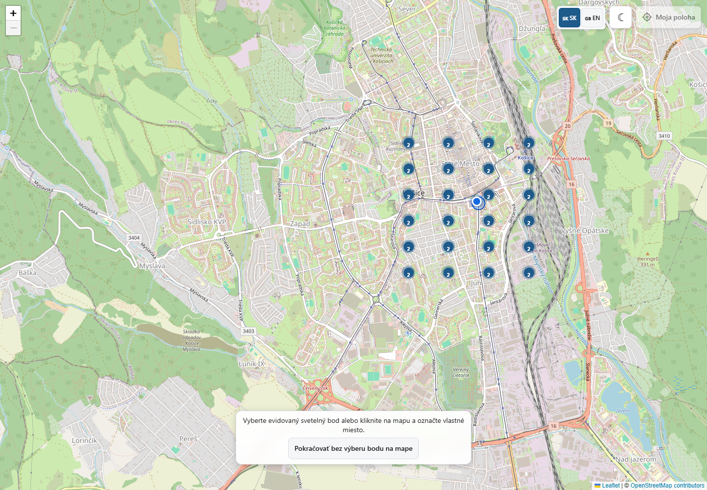
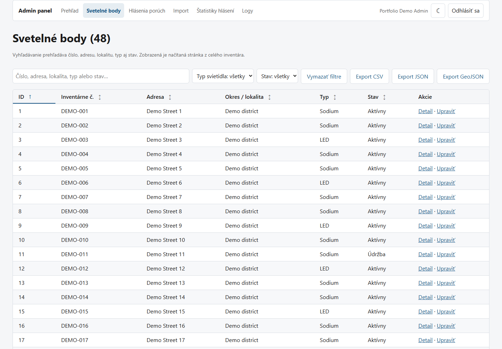
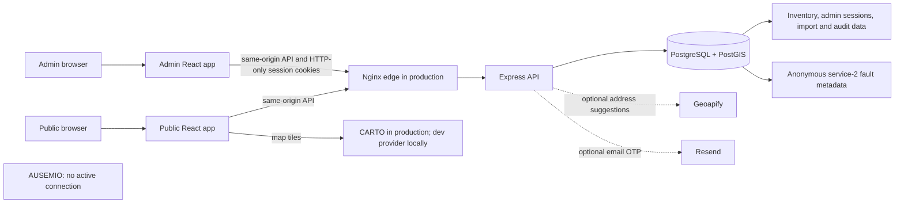

# Public lighting fault reporting

A full-stack web application for finding public streetlights in Košice and preparing a service-2 / VO fault report. It combines an interactive map, a public reporting flow, and an authenticated inventory administration workspace.

> **Project status:** thesis / production-like project. The configured report receiver records only approved fault metadata in the application's PostgreSQL database when the explicit local-persistence mode is enabled. It does not submit reports to AUSEMIO or constitute official city acceptance. Email verification, provider credentials, and deployment settings are environment-gated.

## Screenshots

These are genuine browser captures from a disposable local Docker stack. The map used OpenStreetMap development tiles and an emulated Košice browser location; the admin table contains 48 generated demo records. No owner inventory, personal data, Resend, Geoapify, CARTO, or AUSEMIO request was used for these captures.

| Public map | Admin inventory |
| --- | --- |
|  |  |

## What is implemented

- Public Košice map with clustered inventory points, manual map-location selection, locality/service-area validation, device-location support, and Slovak/English UI.
- Multi-step service-2 reporting form with validation, resumable local drafts, optional attachments, and operator-only recurrence context.
- Admin authentication using HTTP-only access/refresh cookies; inventory search, filtering, sorting, pagination, create/update/delete, import/export, and audit/history views.
- PostgreSQL/PostGIS-backed inventory and privacy-limited fault history. Permanent fault history contains metadata only; it excludes contact details, free text, attachments, IP addresses, and user identifiers.
- Optional Resend email OTP behind `EMAIL_VERIFICATION_ENABLED`; optional Geoapify report-time address suggestions; CARTO production basemaps. These providers were **not** called during this portfolio preparation.
- A typed internal VO/service-2 mapping boundary exists, but no active AUSEMIO HTTP adapter or external submission path is wired into the application.

See [architecture and data flows](docs/portfolio/architecture.md), [fault history and privacy model](docs/fault-history.md), [email verification](docs/email-verification.md), and the [AUSEMIO contract evidence](docs/research/ausemio/contract-audit.md).

## Technology

| Area | Technologies |
| --- | --- |
| Public and admin applications | React 18, TypeScript, Vite, React Router, Leaflet, React Hook Form, Zod |
| API | Node.js, TypeScript (ESM/NodeNext), Express |
| Database | PostgreSQL 16, PostGIS, versioned SQL migrations |
| Infrastructure | Docker Compose, separate production static app images, Nginx reverse proxy, private Docker networks |
| Verification | Vitest, Testing Library, Playwright, disposable PostgreSQL/PostGIS integration tests, GitHub Actions |

## Architecture



Production and development topologies differ: the root Compose file is a loopback-bound Vite/API/database developer stack; `docker-compose.production.yml` builds separate static public/admin images and routes approved hosts through Nginx to a private API and database. The diagram and network boundaries are described in [architecture.md](docs/portfolio/architecture.md).

## Run a local demo

The repository has a development Compose stack. A safe synthetic demo recipe, including a loopback-only Compose overlay and an opt-in seed that refuses non-demo databases, is in [Local portfolio demo](docs/portfolio/demo-guide.md).

The root `docker-compose.yml` is **development only**. It uses fixed container names and a persistent `pgdata` volume; inspect existing containers and volumes before starting it. Do not run `docker compose down -v` unless you have positively identified the exact disposable volume and intend to delete it.

The migration chain requires `pg_trgm` to be installed by a database administrator before migration `0006` runs. This is a documented setup prerequisite; the migration intentionally fails rather than creating that extension itself. The demo guide shows the local-only command.

## Configuration boundaries

Copy `.env.example` only when you need a new local development config. Do not overwrite an existing `.env`. The template keeps live providers off by default.

| Setting | Default / purpose |
| --- | --- |
| `EMAIL_VERIFICATION_ENABLED` | `false`; Resend API credentials are not needed while disabled. |
| `REPORT_SUBMISSION_MODE` | `disabled`; `local-persistence` requires email verification and stores approved metadata only. |
| `GEOAPIFY_ENABLED` | `false` in the safe development template; production configuration requires a backend key. |
| `VITE_MAP_TILE_PROVIDER` | `disabled` in the template; `dev-osm` is development-only. Production builds use an approved CARTO public key. |
| `NOMINATIM_AUTO_GEOCODE` | `false`; automatic inventory geocoding remains off. |
| AUSEMIO | No active sender is wired. Do not put an AUSEMIO key in the environment. |

Provider credentials belong only in the appropriate local secret store or server-side secret files. Never put secrets in Git or `VITE_*` variables (except the deliberately public, domain-restricted CARTO tile key).

## Tests and builds

Run commands from the relevant package directory:

```powershell
cd frontend
npm ci
npm run typecheck
npm test
npm run coverage
$env:VITE_CARTO_PUBLIC_KEY = 'synthetic-build-only'
npm run build
Remove-Item Env:\VITE_CARTO_PUBLIC_KEY
```

```powershell
cd backend
npm ci
npm run typecheck:tests
npm test
npm run coverage
npm run build
```

Vitest enforces **at least 85% lines and 85% branches separately in each frontend and backend project**. PostgreSQL persistence and concurrency suites require their documented explicit opt-in flags and disposable databases. Browser E2E requires the repository's egress-isolation harness; do not run provider-facing browser scenarios outside that containment. CI job definitions and release gates are in [`.github/workflows/ci.yml`](.github/workflows/ci.yml) and [`.github/workflows/deploy-production.yml`](.github/workflows/deploy-production.yml).

The frontend build-boundary check requires a public CARTO build value; the placeholder above is embedded only in ignored local build output, and no provider request is made by the build. The repository also contains a 50,000-record synthetic inventory performance study. Its measurements are specific to the documented local test host and are not a VPS capacity promise: [inventory performance evidence](docs/performance/inventory-50k.md).

## Project layout

```text
frontend/apps/public/       Public map and report flow
frontend/apps/admin/        Admin authentication and inventory workspace
frontend/shared/            Shared browser contracts and UI utilities
backend/src/routes/         HTTP route mounting and API boundaries
backend/src/controllers/    Request/response handling
backend/src/services/       Inventory, auth, import/export, and report logic
backend/src/db/             PostgreSQL access, migration runner, SQL migrations
database/production/        Production database role/grant procedures
scripts/production/         Release guards, deployment, topology checks
docs/portfolio/             Architecture and safe demo instructions
docs/deployment/            Production topology and operational gates
docs/research/              External contract and project evidence
```

## Status and limitations

- A local-persistence report is an application database record, **not** a report delivered to or accepted by the city.
- AUSEMIO service-2 external submission remains inactive; its server-side contract is not invented. Service 16 / CSS is out of scope.
- Email OTP and provider delivery require explicit configuration and external account/domain gates. No real provider delivery was performed for the screenshots.
- The repository includes a production release workflow, but a green CI run or healthy local containers alone does not prove that the current hosted release is reachable or operational. This documentation pass does not claim a public demo or verify city acceptance.
- Operational backup/restore, monitoring, legal/privacy approval, provider account validity, and live external integration remain distinct release concerns. See [production release and deployment boundary](docs/deployment/production-release.md).

## Portfolio notes

This project demonstrates full-stack TypeScript, API/database integration, geospatial modeling, authenticated admin workflows, safe data import/export, privacy-aware persistence, automated testing, Docker, and a gated release pipeline. It is suitable for junior/graduate full-stack, backend, or platform-oriented interviews. A technical discussion can focus on PostGIS coordinate validation, OTP race handling, import idempotency, privacy-limited reporting, and why the AUSEMIO connector remains deliberately inactive.
