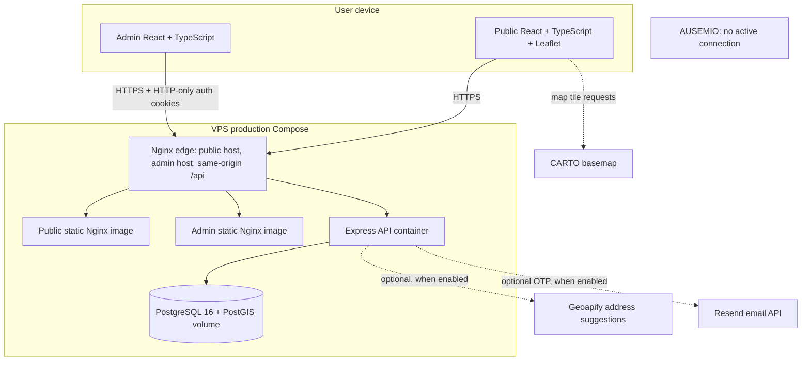

# Architecture and data flows

This document summarizes the checked-in implementation. It distinguishes local development from production packaging and names provider paths that are optional or intentionally inactive.

## Components

Production has separate public/admin static images and a single Nginx ingress. PostgreSQL and Express are not host-published in `docker-compose.production.yml`; private Docker networks connect the services. The public CARTO key is part of the public map build and must be restricted at the provider. Geoapify and Resend keys are backend-side file secrets.

The root `docker-compose.yml` is a different developer topology: PostGIS, Express, and the two Vite development servers are published only on loopback ports. Vite proxies `/api` to the backend. Do not treat that root Compose stack as the production image topology.

## Main request flows

### Public map and location validation

1. The public React app loads inventory points from the Express API.
2. Leaflet renders the points and requests map tiles directly from the configured tile provider.
3. Inventory selection uses the stored point identity/coordinates. Manual map locations are checked by the service-area validation API before the user proceeds.
4. Optional report-time address suggestions use the backend Geoapify adapter. Automatic Nominatim inventory geocoding remains disabled.

### Report form and local persistence

The report form is validated on both client and server. The local receiver uses a typed internal service-2 / VO mapping boundary; it does not encode an assumed AUSEMIO wire protocol. In `REPORT_SUBMISSION_MODE=local-persistence`, the backend stores only approved metadata in `fault_report_history` and a short-lived opaque retry receipt. Contact details, description, attachment bytes, network identifiers, and OTP values are not permanent report-history fields. Attachments are bounded and discarded by the metadata-only receiver.

Recurrence context is calculated for the explicitly selected inventory point and remains operator-facing. Manual/custom/device locations do not gain inventory-based history notes. See [fault history and privacy](../fault-history.md).

### Admin API

The admin application authenticates through HTTP-only access/refresh cookies. Protected Express routes expose inventory CRUD, import batches, streaming exports, audit events, and logs. PostgreSQL transactions and constraints form the persistence boundary; migration SQL is versioned and checksummed. The admin frontend has its own production build and origin.

### Optional provider paths and excluded path

- **CARTO:** map tiles are requested directly by the browser. The local screenshots use the development OpenStreetMap tile mode, not CARTO.
- **Geoapify:** server-side address suggestion, disabled in the safe `.env.example`; production configuration requires the provider key and approved account/privacy gates.
- **Resend:** email OTP only when `EMAIL_VERIFICATION_ENABLED=true`; it is off by default and needs a verified sender/domain.
- **Nominatim:** automatic inventory geocoding is explicitly off.
- **AUSEMIO:** no active network adapter or report submission path exists. The internal mapping boundary does not imply an external write or acceptance.

## Data boundary

PostgreSQL holds the lighting inventory, admin accounts/sessions, import/audit records, optional verification digests, and metadata-only report history. The fault-history table is deliberately separate from the original report form payload. Schema details and retention limits are documented in [fault-history.md](../fault-history.md) and [email-verification.md](../email-verification.md).

## Build, CI, and release boundary

GitHub Actions has separate frontend and backend jobs with coverage thresholds, plus SQL/research/dependency evidence and browser E2E under egress isolation. The production deployment workflow is triggered by successful CI for a `master` push and verifies exact repository/SHA/job identity before requesting a forced-command host release. Workflow presence is not evidence that an arbitrary current VPS is reachable, healthy, or receiving official city reports. See [production release notes](../deployment/production-release.md).
